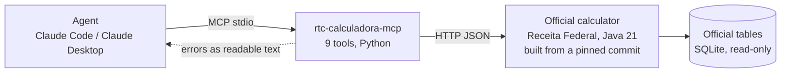

# rtc-calculadora-mcp


An [MCP](https://modelcontextprotocol.io) server that gives AI agents the **official calculator of Brazil's consumption-tax reform** (CBS, IBS and Imposto Seletivo, LC 214/2025) as tools.

The Receita Federal published the calculator as open source ([`calculadora-rtc-regime-regular`](https://github.com/ReceitaFederal/calculadora-rtc-regime-regular), MIT). It is a Java REST API with the official tables: tax situations (CST), tax classifications (`cClassTrib`), NCM/NBS links, reduction percentages and reference rates. This project does not reimplement any tax rule. It runs that calculator unchanged and puts a thin layer of nine small tools in front of it. The agent never does the arithmetic: it sends the operation, and the calculator returns the values, or an error that the agent can read.

> **PT-BR:** servidor MCP que expõe a calculadora oficial da Reforma Tributária (Receita Federal, MIT) como ferramentas para agentes de IA. O agente não faz conta: manda a operação e repassa o que a calculadora oficial devolve. A avaliação com 30 cenários fictícios compara o mesmo modelo sozinho e com o MCP, usando a própria calculadora como gabarito.

**Personal, independent project.** It is not affiliated with or endorsed by the Receita Federal, SERPRO or any employer. It uses only the Receita's public code and fictitious data. This is not tax advice.

## How it fits together



The calculator runs as a Docker container. [`calculadora/Dockerfile`](calculadora/Dockerfile) clones the Receita's repository at one pinned commit (release 1.6.1, database V0059), builds the official tables and the jar with the project's own Maven wrapper, and runs it. No code from that repository is copied into this one.

## Tools

| Tool | What it does | Calculator endpoint |
|---|---|---|
| `calcular_tributos` | Calculates CBS, IBS (state and municipal) and IS for an operation. By default each item is calculated on its own, and items with errors come back with the reason. `estrito=true` rejects the whole operation at the first error. | `POST /observabilidade/regime-geral`, `POST /regime-geral` |
| `descrever_erro` | Explains an error code such as `REG-011` | `GET /observabilidade/erros` |
| `consultar_classificacao_tributaria` | Reads one `cClassTrib`: treatment, reduction percentages, NCM or NBS, allowed documents | `GET /dados-abertos/classificacoes-tributarias/...` |
| `listar_situacoes_tributarias` | Lists CSTs and their classifications, or the classifications of one CST | `GET /dados-abertos/situacoes-tributarias/...` |
| `consultar_nomenclatura` | Looks up an NCM (goods) or NBS (services) code, including whether IS applies | `GET /dados-abertos/ncm`, `/nbs` |
| `verificar_enquadramento` | Says whether an NCM or NBS can be used with a `cClassTrib` on a date | `GET /dados-abertos/classificacoes-tributarias/{ncm,nbs}-aplicavel` |
| `consultar_aliquota_referencia` | Reference rate for the Union (CBS), a state or a municipality (IBS). The official table only has 2026. | `GET /dados-abertos/aliquota-*` |
| `gerar_xml_grupo` | Calculates in strict mode and generates the official XML tax groups for NF-e, NFC-e, CT-e, BP-e or NF3e | `POST /regime-geral` + `POST /xml/generate` |
| `validar_xml` | Validates a group or a whole document against the official XSD and returns the line and column of the error | `POST /xml/validate` |

Every calculator error becomes one line the agent can act on, for example:

```
Calculadora RTC recusou a requisicao: HTTP 422 - NCM não vinculada: NCM de código 02013000 não vinculada à Classificação Tributária de código 200035 (CBS e IBS)
Calculadora RTC indisponivel: nao foi possivel conectar em http://localhost:8080/api/calculadora (ConnectError). Suba a calculadora oficial com `docker compose up -d` e confira RTC_URL.
```

Tool names, descriptions and messages are in Portuguese because the domain, the field names (`cClassTrib`, `vCBS`) and the people who use them are Brazilian.

## Run it

Requirements: Docker and [uv](https://docs.astral.sh/uv/).

```bash
git clone https://github.com/tmoreiradev/rtc-calculadora-mcp
cd rtc-calculadora-mcp
docker compose up -d --build --wait   # first build takes a few minutes (Maven + official tables)
uv sync
uv run pytest -m contract             # optional: checks the tools against the real calculator
```

The calculator listens on `127.0.0.1:8080` only. Its Swagger UI is at `http://localhost:8080/api/swagger-ui.html`. To use a calculator somewhere else, set `RTC_URL` (default `http://localhost:8080/api/calculadora`).

### Claude Code

```bash
claude mcp add rtc -- uv run --directory /path/to/rtc-calculadora-mcp rtc-calculadora-mcp
```

### Claude Desktop

Add this to `claude_desktop_config.json`:

```json
{
  "mcpServers": {
    "rtc": {
      "command": "uv",
      "args": ["run", "--directory", "/path/to/rtc-calculadora-mcp", "rtc-calculadora-mcp"],
      "env": { "RTC_URL": "http://localhost:8080/api/calculadora" }
    }
  }
}
```

Then ask something like *"Calculate CBS and IBS for 20 litres of UHT milk, NCM 04011010, cClassTrib 200003, R$ 89.90, Porto Alegre, March 2027, rates 8.8 / 0.05 / 0.05"*.

## Evaluation

**Question:** if you give the same model the same operation, does it get the official numbers right on its own, and how much does the MCP change that?

- **Scenarios:** [30 fictitious operations](eval/scenarios.py) with 37 items in total. They cover the 2026 test year (rates come from the official table), 2027 to 2033 with informed rates, reduced and zero rates (food basket, education, health, medical devices, liberal professions, hotels), Imposto Seletivo on beverages, and five items that the calculator rejects: rates informed before 2027, rates missing from 2027, an NCM that is not linked to its `cClassTrib` (twice), and a CBS/IBS base that ignores the IS.
- **Answer key:** whatever the official calculator returns ([`eval/gabarito.json`](eval/gabarito.json)). Nobody typed the expected values by hand. CI rebuilds the calculator and checks that the answer key still matches it.
- **Runs:** [`eval/run.py`](eval/run.py) (Claude Code CLI 2.1.327) asks `claude -p --output-format json` for each scenario twice, with the same system prompt and the same user prompt. The only difference is whether this MCP server is attached. Each run is isolated from my own setup: empty temporary directory, no setting sources (no CLAUDE.md, hooks or personal MCP servers) and no built-in tools. Cost and tokens are the numbers the CLI reports.
- **Scoring:** [`eval/score.py`](eval/score.py). A value is correct when it is within R$ 0.01 of the calculator's. An invalid item counts as detected only when the answer gives an error and no values. Raw answers are in [`eval/results/`](eval/results), and every item's comparison is in [`eval/results/detail.json`](eval/results/detail.json).

**Results** (Claude Sonnet 5.5, one run per scenario per mode; full output in [`eval/RESULTS.md`](eval/RESULTS.md)):

| Metric | LLM alone | LLM + MCP |
|---|---|---|
| Scenarios fully correct | 17/30 (57%) | 30/30 (100%) |
| Tax values correct (±R$ 0.01) | 70/99 (71%) | 99/99 (100%) |
| Tax values exact to the cent | 70/99 (71%) | 99/99 (100%) |
| Tax values wrong | 17 | 0 |
| Tax values missing | 12 | 0 |
| Valid items wrongly rejected | 3 | 0 |
| Invalid items flagged as errors | 1/5 (20%) | 5/5 (100%) |
| Invalid items given made-up values | 4 | 0 |
| Imposto Seletivo invented where there is none | 0 | 0 |
| Unparseable answers | 0 | 0 |
| Total cost (USD, as reported by the CLI) | 0.53 | 0.51 |
| Input tokens (incl. cache) / output tokens | 44,851 / 34,892 | 372,098 / 11,805 |
| Mean turns per scenario | 1.0 | 2.4 |
| Median wall time per scenario (s) | 13.5 | 10.2 |

What went wrong without the tools, from [`detail.json`](eval/results/detail.json):

- **It calculated items that the calculator rejects** (4 of 5). It used informed rates in 2026, when they are not allowed. It assumed a default rate in 2027, when the rates are missing. It accepted an NCM that is not linked to its `cClassTrib`. It accepted a CBS/IBS base that ignores the Imposto Seletivo.
- **It used the wrong reduction for a classification** (liberal professions, hotels, medical devices). These percentages live in the official tables, not in the model.
- **It refused valid Imposto Seletivo items** (3). There, the calculator derives the CBS/IBS base from the IS base plus the IS, and the model asked for a base that is not needed.
- **It made plain arithmetic and rounding slips**, such as R$ 365.40 instead of R$ 369.60, or R$ 0.00 instead of R$ 0.44.

With the MCP, every value matched the calculator. That is expected when the model copies numbers that the calculator produced. The saved records keep the final answers, the turn counts (2.4 turns per scenario on average, against 1.0 without tools) and the token usage, but not the individual tool calls. So the table proves that the answers agree with the calculator. It does not show which tools were called. The MCP runs used about 8 times more input tokens, because the tool schemas and results enter the context. Most of those tokens were cache reads, so the reported cost was about the same, and the median wall time was shorter, because the model wrote less.

### Limitations of this evaluation

- **One run per mode, one model.** There are no repeated runs and no confidence intervals. A different model, prompt or day can move the "alone" column a lot. The MCP column depends far less on the model, because the model only copies the calculator's output.
- **The prompt hands over the calculator's input format.** Both modes receive the operation as the JSON that the calculator expects, with CST, `cClassTrib` and rates already chosen. This measures *calculating*, not *classifying*. Picking the right `cClassTrib` for a product description is the harder real-world problem, and this evaluation does not test it.
- **The answer key is the calculator.** If the calculator has a bug, both the key and the MCP answers inherit it. The point is agreement with the official reference implementation, not legal correctness.
- **30 scenarios is a small set.** It covers the main mechanisms but not special regimes, government purchases, deferral, presumed credit, NFS-e or the Simples Nacional.
- **The "alone" column is the model without tools.** A model with a code interpreter or web search might do better. That is a different comparison.

## Trade-offs

- **Run the official calculator, don't port it.** A port would be lighter (no JVM, no 100 MB jar) but would drift from the reference with every release of the tables. The Docker build pins one commit, so an upgrade is a one-line change and the contract tests show what moved.
- **Per-item calculation by default.** The calculator's "observability" endpoint returns one result per item and keeps going after an error, so the agent can tell which item is wrong and fix it. Strict mode is still available, and `gerar_xml_grupo` uses it because a document must not be generated from a partial calculation.
- **Thin tools, raw official fields.** The tools return the calculator's own JSON, minus the long calculation-memory texts unless the caller asks for them. Renaming fields would make the output prettier and harder to check against the official layout.
- **Free-form `operacao` object.** `calcular_tributos` takes the calculator's input as a JSON object instead of a fully typed schema. The calculator validates it and returns precise errors. Duplicating that validation here would mean keeping two copies of the rules in sync.

## What I would change

- Add the [Simples Nacional calculator](https://github.com/ReceitaFederal/calculadora-rtc-simples-nacional) as a second backend.
- Add a classification step to the evaluation: start from a product description, so the model has to find the `cClassTrib` through the lookup tools. That is where an agent needs the tables most.
- Repeat each scenario several times and with more than one model, and report the spread.
- Publish a prebuilt image of the calculator, so that users do not need the Maven build.

## Development

```bash
uv run pytest                      # unit tests, calculator mocked (what CI's first job runs)
docker compose up -d --build --wait
uv run pytest -m contract          # contract tests against the real calculator (CI's second job)
uv run python -m eval.gabarito     # rebuild the answer key from the calculator
uv run python -m eval.run --mode baseline && uv run python -m eval.run --mode mcp
uv run python -m eval.score        # rewrite eval/RESULTS.md
```

## Credits and license

The tax rules, tables, XSDs and calculation engine belong to the [Receita Federal do Brasil](https://github.com/ReceitaFederal/calculadora-rtc-regime-regular), published under the MIT license (copyright 2026 Receita Federal do Brasil). The Docker image built by this project includes the calculator's license as `LICENSE-calculadora-rtc`.

This project's own code is under the [MIT license](LICENSE).
